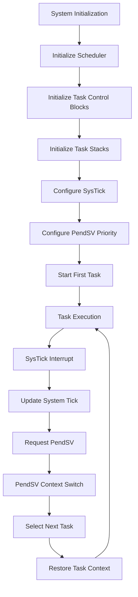
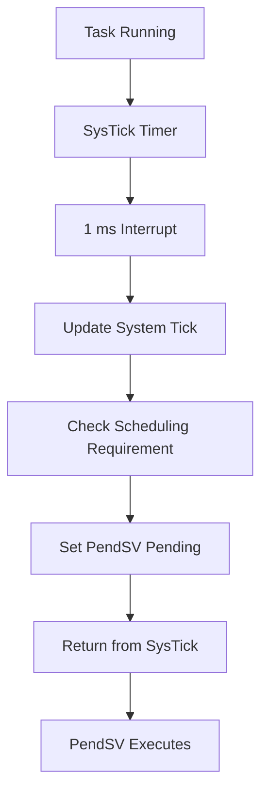
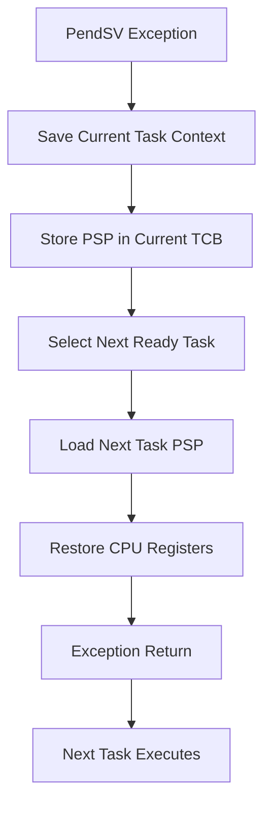
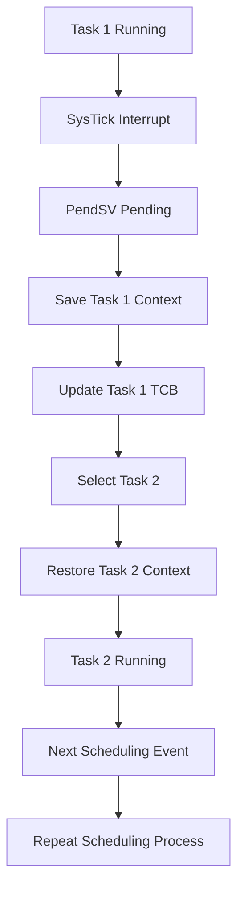
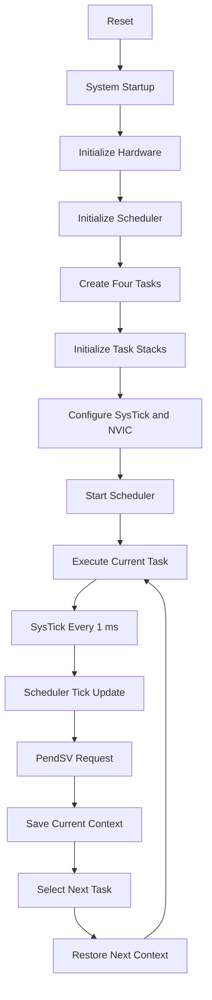

# Real-Time Task Scheduler – ARM Cortex-M

## Overview

A **bare-metal preemptive Real-Time Task Scheduler** developed using Embedded C for the STM32F103 Blue Pill microcontroller based on the ARM Cortex-M3 processor.

The project implements task scheduling and context switching without using an RTOS such as FreeRTOS.

It uses the **SysTick exception** to generate periodic system ticks and the **PendSV exception** to perform task context switching. Separate stack management using the Main Stack Pointer (MSP) and Process Stack Pointer (PSP) provides an independent execution environment for each task.

The scheduler is designed to manage four independent application tasks using a priority-based exception mechanism and round-robin task selection.

## Key Features

- Bare-metal task scheduling without FreeRTOS
- Preemptive multitasking architecture
- Four independent application tasks
- 1 ms SysTick periodic interrupt
- PendSV-based context switching
- MSP and PSP stack management
- Manual task stack initialization
- Task Control Block (TCB) management
- CPU register context preservation
- NVIC interrupt priority configuration
- Exception-driven task switching
- Independent stack allocation for tasks

## Hardware Requirements

| Component | Description |
|---|---|
| STM32F103C8T6 Blue Pill | Main microcontroller |
| ARM Cortex-M3 | Processor architecture |
| ST-Link | Programming and debugging |
| USB-to-UART converter | Optional serial debugging |
| 3.3 V power supply | Board power |

## Software and Development Tools

- STM32CubeIDE
- Embedded C
- ARM Cortex-M3
- CMSIS
- STM32 startup and linker configuration
- Git and GitHub

## System Architecture

The scheduler uses two important exceptions:

**SysTick**
- Generates a periodic 1 ms system tick.
- Maintains the scheduler time base.
- Initiates scheduling decisions.

**PendSV**
- Executes the actual context switch.
- Saves the current task's CPU context.
- Restores the next task's CPU context.
- Runs at the lowest exception priority so it does not unnecessarily interfere with higher-priority interrupts.

### Architecture Flowchart



## Scheduler Components

### 1. Task Control Block (TCB)

A Task Control Block maintains the information required to manage an individual task.

Typical TCB information includes:

- Task stack pointer
- Task stack memory
- Task state
- Task identification

Each application task has its own TCB and stack.

### 2. SysTick Timer

SysTick is a 24-bit system timer available in ARM Cortex-M processors.

In this project, SysTick is configured to generate an interrupt every **1 millisecond**.

<math block value="T_{tick}=1\\text{ ms}"/>

The SysTick handler provides the periodic timing reference for the scheduler.

#### SysTick Working Flow



### 3. PendSV Exception

PendSV is used to perform context switching between tasks.

It is configured at the lowest exception priority so that higher-priority interrupts can execute before the scheduler performs the context switch.

The PendSV handler performs two major operations:

**Context Save**
- Save the current task's CPU registers.
- Preserve the current task's stack pointer.
- Update the current task's TCB.

**Context Restore**
- Select the next ready task.
- Load its saved stack pointer.
- Restore its CPU registers.
- Resume execution of that task.

#### PendSV Context Switching Flow



## Context Switching

Context switching allows the processor to stop executing one task and resume another task while preserving their execution states.

For Cortex-M3, the processor automatically stacks part of the exception context during exception entry. The scheduler handles the remaining software-managed register context.

### Context Switching Process

1. A SysTick interrupt occurs.
2. The scheduler requests a PendSV exception.
3. PendSV saves the current task's remaining CPU context.
4. The current stack pointer is stored in its TCB.
5. The scheduler selects the next ready task.
6. The next task's saved stack pointer is loaded.
7. Its CPU context is restored.
8. Exception return resumes the selected task.

### Context Switching Diagram



## Stack Management – MSP and PSP

The ARM Cortex-M3 processor provides two stack pointers.

| Stack Pointer | Purpose |
|---|---|
| MSP – Main Stack Pointer | Used for handler mode and system-level execution |
| PSP – Process Stack Pointer | Used for application task execution |

This project uses separate task stacks through PSP while MSP is maintained for exception and handler execution.

### Stack Architecture

```text
          ARM Cortex-M3
        +------------------+
        |   Main Stack     |
        |       MSP        |
        +------------------+

        +------------------+
        |   Task 1 Stack   |
        |       PSP        |
        +------------------+

        +------------------+
        |   Task 2 Stack   |
        +------------------+

        +------------------+
        |   Task 3 Stack   |
        +------------------+

        +------------------+
        |   Task 4 Stack   |
        +------------------+
```

### Initial Task Stack

Before a task begins execution, its stack must be initialized with an initial CPU context.

This allows the processor to restore the task through the exception-return mechanism.

The initial stack frame must contain the required register values, including the task entry address and an appropriate exception-return value.

## Task Management

The scheduler is designed to manage four independent application tasks.

| Task | Description |
|---|---|
| Task 1 | Independent application task |
| Task 2 | Independent application task |
| Task 3 | Independent application task |
| Task 4 | Independent application task |

Each task has its own execution stack and task context.

The scheduler selects the next ready task using its task-selection mechanism.

## Memory and Timing Configuration

| Parameter | Configuration |
|---|---|
| Microcontroller | STM32F103C8T6 |
| Processor | ARM Cortex-M3 |
| Scheduler Type | Bare-metal preemptive scheduler |
| Application Tasks | 4 |
| SysTick Interval | 1 ms |
| Tick Frequency | 1000 Hz |
| Individual Task Stack | 1024 bytes |
| Scheduler Stack | 1024 bytes |
| Task Stack Pointer | PSP |
| Handler Stack Pointer | MSP |
| Context Switching | PendSV |
| RTOS Dependency | None |

## Overall Scheduler Execution



## Important ARM Cortex-M3 Concepts Demonstrated

- ARM Cortex-M3 exception handling
- SysTick timer configuration
- PendSV exception handling
- NVIC interrupt priority configuration
- Main Stack Pointer (MSP)
- Process Stack Pointer (PSP)
- CPU register preservation
- Initial task stack construction
- Exception entry and return
- Task Control Block management
- Preemptive scheduling
- Bare-metal firmware development

## Build and Run

### 1. Clone the Repository

```bash
git clone https://github.com/Athikari-Thejesh/timers.git
```

Replace the repository URL above with the actual task scheduler repository URL if it is hosted separately.

### 2. Open the Project

Open the project in STM32CubeIDE.

### 3. Build the Firmware

Select:

```text
Project → Build Project
```

### 4. Flash the Microcontroller

Connect the STM32F103C8T6 Blue Pill using an ST-Link programmer and flash the generated firmware.

### 5. Debug the Scheduler

Use STM32CubeIDE debugging tools to inspect:

- SysTick interrupt execution
- PendSV exception execution
- MSP and PSP values
- Task stack memory
- Task switching sequence
- CPU register context

## Advantages

- No external RTOS dependency.
- Direct understanding of ARM Cortex-M exception handling.
- Independent stack management for application tasks.
- Separation of scheduler and task execution.
- Efficient exception-based context switching.
- Better understanding of low-level firmware architecture.

## Future Improvements

- Dynamic task creation and deletion
- Task priority management
- Blocking and delay states
- Semaphore and mutex support
- Software timers
- Stack overflow detection
- Runtime task statistics
- Scheduler execution-time measurement
- UART-based task monitoring

## Project Summary

This project demonstrates the internal working principles of a real-time preemptive scheduler using ARM Cortex-M3 exception mechanisms.

By implementing SysTick-based timing, PendSV-based context switching, TCB management, and independent task stacks, it provides practical experience in low-level embedded firmware development without relying on an external RTOS.

**Technologies:** Embedded C | ARM Cortex-M3 | STM32F103C8T6 | SysTick | PendSV | NVIC | MSP | PSP | Bare-Metal Programming
